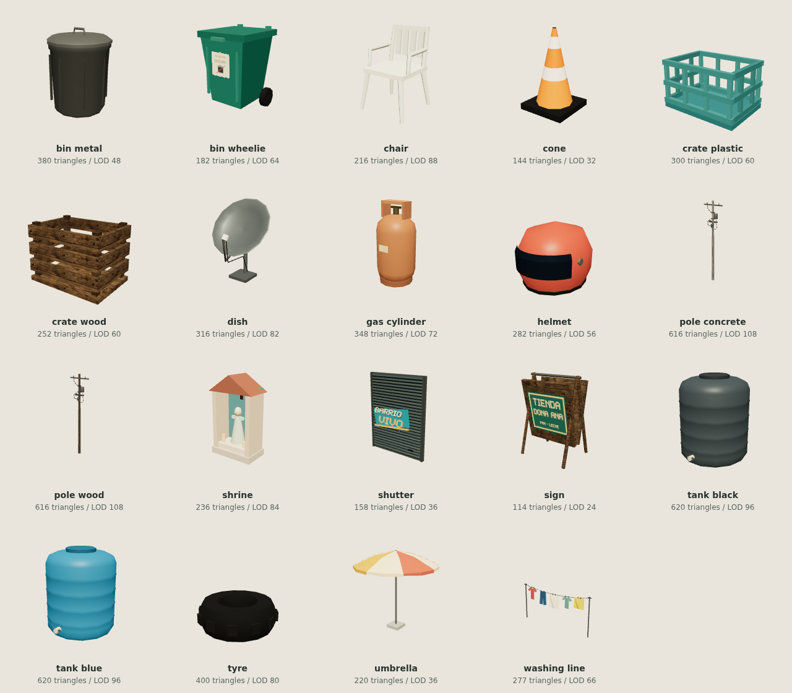
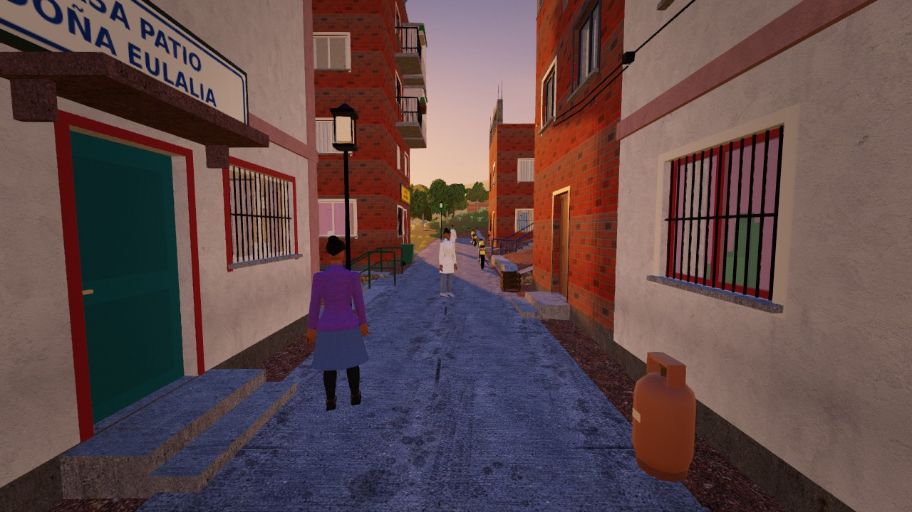
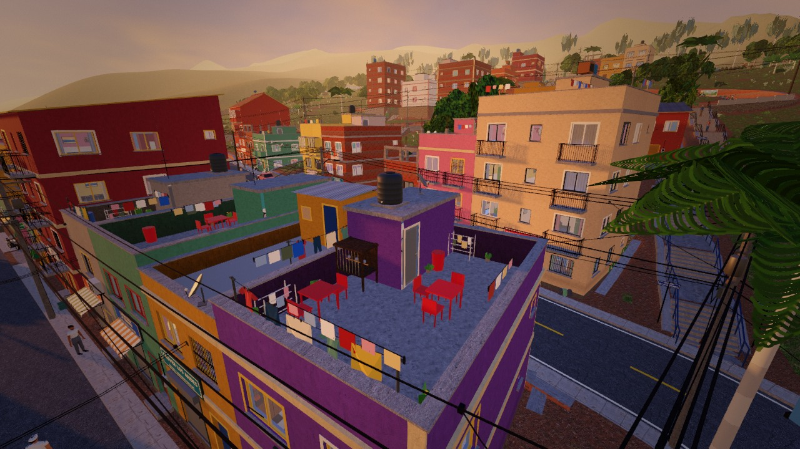
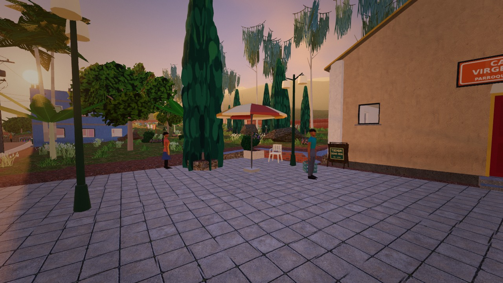

# Clutter library verification — 31 October 2026

Branch: `feat/la-ladera-clutter-library`.

Base: `origin/main` at `8fa06a5498555afc5dc2b636c06754a4a6b5882c`.
The request supplied a `<SHA>` placeholder, so the fetched main revision was
used. This revision has an empty furniture manifest and does not contain
`FURNITURE.md` or `furn_validate.mjs`; its available `furn_lib.py` and
`furn_build.py` establish the pipeline reused here. Its measured payload and
test inventory differ from the figures in the request. The before evidence is
from an unchanged copy of this exact revision, including the root page assets.

## Delivered and loaded

- 19 catalogue designs, each with an explicit low-detail node: **38 catalogue
  roots** (118 GLB nodes including the 80 material-part nodes).
- **609,814 bytes total**: GLB 565,756; manifest 24,825; atlas 19,233.
  This includes both LODs and is below the strict 2,000,000-byte library limit.
- Ordinary designs have 114–400 triangles at the near LOD, poles 616 and tanks
  620. Every low LOD is smaller and independently checked from binary geometry.
- The GLB has no embedded textures. Material names resolve through the game
  library; one external atlas supplies eight graffiti, poster and sign cells.
- The default world contains **128 instances: 96 procedural replacements and
  32 additions**, covering all 19 keys, plus 24 wall decal quads. There are 18
  ground additions, 10 helmets on actual transformed motorbike seats and four
  spare shutters on blank wall panels.
- Instance batches share geometry/materials and select one LOD with distance
  hysteresis. Small distant props are culled. Clutter receives existing shadows
  but does not cast extra shadow passes; this is a deliberate budget tradeoff.
- Original procedural generators remain available if either LOD fails to load.
  `?clutter=0` explicitly selects that fallback. Existing support pads, utility
  cable anchors, collision/discovery behavior and navigation are preserved.

The [after capture data](after/views.json) records the successful load of
`clutter/clutter.glb`, all 19 keys and no failed assets. The delivered
[manifest](../../assets/models/manifest.clutter.json),
[GLB](../../assets/models/clutter/clutter.glb) and
[atlas](../../assets/textures/clutter/decals.png) are committed files.



## Three matched views

All six captures use headless Chrome, 1280 × 720, fixed high quality, hour 17.2,
manual stepping and the exact camera positions/orientations in
[poses.json](poses.json). The before and after camera arrays match. Counts are
the renderer's complete rendered-frame triangle and draw-call counts, including
the existing scene's passes. They are not just clutter geometry totals.

| View | Before triangles | After triangles | Triangle change | Before calls | After calls | Call change |
| --- | ---: | ---: | ---: | ---: | ---: | ---: |
| Alley | 1,224,611 | 1,214,845 | −9,766 | 697 | 707 | +10 |
| Rooftop | 1,553,517 | 1,543,748 | −9,769 | 1,068 | 1,068 | 0 |
| Plaza | 676,952 | 676,184 | −768 | 418 | 428 | +10 |

All three after views are below 2.5 million triangles and 1,800 draw calls.
Both capture reports have `failures: []`, no application errors, no missing
requests and no build errors. Chrome's screenshot-related `ReadPixels`
performance warnings are preserved separately in the reports.

The conservative sum of **all 128 instances at their near LOD**, plus all 24
wall quads, is 50,913 triangles before subtracting any replaced procedural
geometry or applying distance/frustum culling. The corresponding all-far sum
is 10,158. This bound describes the added library geometry; it does not certify
the maximum complete frame across every possible view.

| Scene | Before | After |
| --- | --- | --- |
| Alley | [Before image](before/alley.jpg) | [After image](after/alley.jpg) |
| Rooftop | [Before image](before/rooftop.jpg) | [After image](after/rooftop.jpg) |
| Plaza | [Before image](before/plaza.jpg) | [After image](after/plaza.jpg) |







Visual inspection also caught and corrected a helmet visor intersection and
Blender's exported V-coordinate inversion on decals. The final contact sheet
shows the corrected visor, upright sign and intended bin/shutter artwork.

## Tests and payload

| Check | Result | Evidence |
| --- | --- | --- |
| Before world tests | 37 passed, zero failures | [TAP](verification/before-world-tests.tap) |
| After world, facade and clutter tests | 72 passed, zero failures or skips | [TAP](verification/after-world-tests.tap) |
| Binary asset validator, `--complete` | Passed; 19 designs, 19 LODs, 609,814 bytes | [Validator output](verification/validator.txt) |
| Asset validation regressions | 19 passed, included in after suite | [Tests](../../tests/clutter-assets.test.mjs) |
| Runtime clutter regressions | 7 passed, included in after suite | [Tests](../../tests/world-clutter.test.mjs) |
| Before payload budget | Passed; 17.49 MiB shipped | [JSON](verification/before-payload.json) |
| After payload budget | Passed; 18.09 MiB shipped | [JSON](verification/after-payload.json) |
| Two clean Blender regenerations | Byte-identical GLB, manifest and atlas | [Regeneration output](verification/regeneration.txt) |

The existing payload tool labels its units “MB” but divides by 1,048,576; this
report uses MiB. Its shipped total excludes vendor, dev, labs, tests and tools,
so the review images are not counted as game payload. The library's strict
byte limit above is independent of that site-wide budget calculation.

The broader untouched-baseline non-browser test sweep contains 288 tests:
285 pass, two fail and one skips. The existing Linux failures are the
wrong-case import diagnostic assertion in `live-paths.test.mjs` and the
missing-command exit-code assertion (126 versus 127) in `nice.test.mjs`.
[Full baseline TAP](verification/baseline-node-tests.tap) is retained. The
requested world tests pass; this report does not claim the approximately 930
tests mentioned in the request exist on this source revision.

## Metrics and timing limitation

The unchanged `tests/metrics.mjs` was run before and after with its original
12 ms, 2.5-million-triangle and 1,800-call gates. Both runs requested 40 views
and a 60-second simulated navigation soak. The matched query fixed high
quality and time of day; manual mode was necessary to make measurements
progress on this machine.

Renderer: `ANGLE (Google, Vulkan 1.3.0 (SwiftShader Device (Subzero)
(0x0000C0DE)), SwiftShader driver)`, Chrome 156.0.8078.79 on Linux.

The before run measured the spawn view at 1,529,993 triangles, 1,075 draw calls
and 15.13 ms uncapped render cost. Boot took 39.4 seconds, over the existing
25-second gate; the next measurement hit the CDP timeout. Its full scan and
soak did not complete. See [before metrics](verification/before-metrics.json).

The after run measured the spawn view at 1,518,526 triangles, 1,074 draw calls
and 27.07 ms uncapped render cost. Boot took 31.5 seconds; it also timed out
at the next measurement before the soak. See
[after metrics](verification/after-metrics.json). Both commands exited with
failed gates. The spawn geometry change is −11,467 triangles and −1 draw call;
the timing samples are not evidence of a performance improvement.

| Matched metrics run | Completed views of 40 requested | Boot | Spawn render cost | Result |
| --- | ---: | ---: | ---: | --- |
| Before | 1 | 39.4 s | 15.13 ms | Boot/render gates failed; CDP timeout |
| After | 1 | 31.5 s | 27.07 ms | Boot/render gates failed; CDP timeout |

An initial [live-loop baseline run](verification/before-metrics-live-loop.json)
also timed out during boot. Repeated baseline attempts on this shared
software-renderer host gave materially different timing samples. Exact causes
of the stalls were not established, and are not attributed to the new assets.

A final bounded baseline attempt (`--views 1 --soak 10`, 300-second outer
timeout) measured spawn at 17.59 ms, with no application errors or 404s, then
stalled during the second page load before the soak. Its
[JSON report](verification/before-metrics-spawn-soak.json) is retained; no
matching shortened after run was attempted once that baseline also failed.

These software-rendered results do **not** certify the 12 ms hardware frame
budget or a full-world maximum triangle count. The 16.7 ms rAF figure in a
manual run measures idle callback cadence, not live game FPS. No metric
threshold was weakened. A representative GPU run of the unchanged metrics
tool remains required for timing sign-off and the full view/soak gate.

## Reproduce

Use the existing quiet wrapper; every browser remains headless and Blender
runs with `--background`. No visible application windows are needed.

From the repository root, the generation and asset validation commands are
documented in [CLUTTER.md](../../tools/blender/CLUTTER.md). Capture commands:

```sh
node la-ladera/tools/nice.mjs node la-ladera/tests/clutter-gallery.mjs
node la-ladera/tools/nice.mjs node la-ladera/tests/clutter-shots.mjs --out la-ladera/dev/clutter-review/after
node la-ladera/tools/nice.mjs node la-ladera/tests/clutter-shots.mjs --root /path/to/unchanged-base --out la-ladera/dev/clutter-review/before
```

The unchanged base must include root `almanac-back.js` and `favicon.ico`, as
well as `la-ladera/` and `package.json`. Set `CHROME_PATH` if Chrome is not on
the test driver's normal search path. Browser jobs use `tests/chrome.mjs`.

The matched metric command, run once in each checkout, was:

```sh
node la-ladera/tools/nice.mjs node la-ladera/tests/metrics.mjs --w 1280 --h 720 --views 40 --soak 60 --query 'manual&quality=high&hour=17.2&audio=0' --json metrics.json
```

For a normal live-loop hardware timing check, omit `manual&` from the query.
The local headless Chrome wrapper additionally used
`--disable-dev-shm-usage --disable-extensions --num-raster-threads=2
--disable-background-timer-throttling --disable-renderer-backgrounding
--disable-backgrounding-occluded-windows`; it did not change game gates.

World and asset test commands:

```sh
# In the untouched base:
node la-ladera/tools/nice.mjs node --import ./la-ladera/tests/register.mjs --test --test-reporter=tap --test-concurrency=1 la-ladera/tests/world-*.test.mjs
# In this branch:
node la-ladera/tools/nice.mjs node --import ./la-ladera/tests/register.mjs --test --test-reporter=tap --test-concurrency=1 la-ladera/tests/world-*.test.mjs la-ladera/tests/arch-facade.test.mjs la-ladera/tests/clutter-assets.test.mjs
```

Final SHA-256 hashes (also verified by the second clean regeneration):

```text
2d020c6ca92ddbeec16819139cc44a5288fd8eba09a7eb7161e611a9e583c782  assets/models/clutter/clutter.glb
14aefe50b1b8ff3ab7910b04f59e4dcb2f4ee328a782206282e54778701e487d  assets/models/manifest.clutter.json
fca3ef60aaea3b94247126e97fff04aa9548917434cdc228de66b5fb81ee5b99  assets/textures/clutter/decals.png
```
