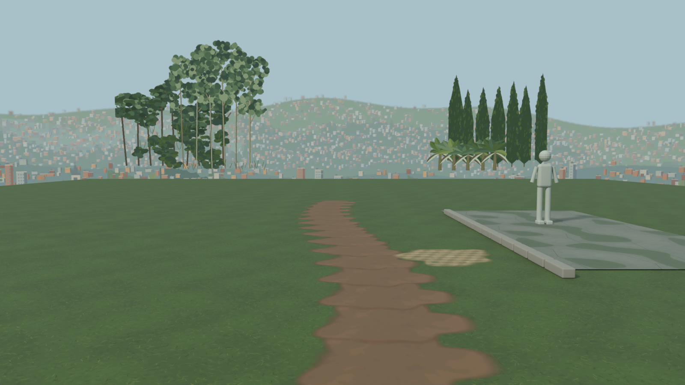
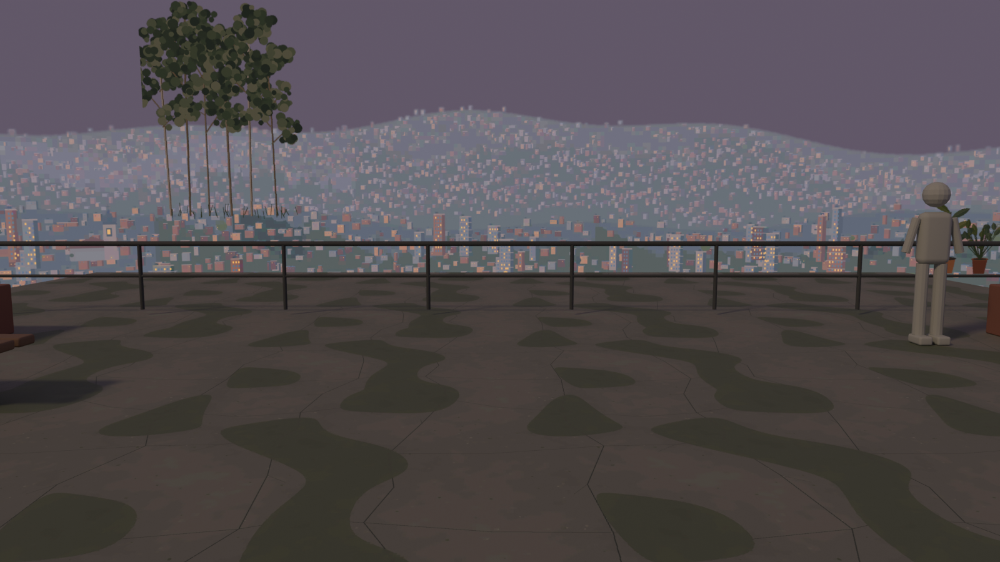

# Ground/Sky verification

Fresh evidence from this implementation session, 2026-11-03 UTC. The complete offline library passes the independent validator, all 34 Node tests, all 34 per-test mutations, and the unchanged repository payload gate. No runtime integration is claimed.

## Base, branch and scope

- Branch: `codex/la-ladera-ground-sky`.
- Initial latest `origin/main` at checkout: `6740a624e597bbed9c9f400d6c33b37924777a17`.

- Immediately before PR publication, fetched `origin/main` and ran `git rebase origin/main` once. Rebase target: `958d0ec69716d0588a7bb8d4534c336edd550f7e`. The rebase completed with exit 0. See [rebase.log](verification/rebase.log).

- Changes are additions only in the requested Ground/Sky namespaces. Existing game JavaScript, boot manifests, registries, tests, payload budgets and other assets are untouched. The manifest has `libraryOnly: true` and `complete: true`.

- Read and followed the existing beach texture README, beach props manifest, beach texture tests/mutation runner and `tools/blender/SUBSTATION2.md`. The new validator and mutation runner are independent modules.

## Inventory and fixed budgets

| Content | Count and resolution |
| --- | --- |
| Ground PBR | 24 sets × albedo/normal/ORM = 72 maps, each 1024 × 1024 |
| Soft ground patches | 16 RGBA decals, each 512 × 512, authored 1–4 m |
| Blend-mask atlas | Eight full-resolution 1024 × 1024 masks packed in two RGBA planes |
| City | Three depth layers × day/dusk/night = nine 4096 × 512 cutouts; 200° arc |
| Haze | Five 256 × 4 ramps at 7, 12, 17.2, 19.5 and 22 h |
| Vegetation | Six families × 1024/512/256 px = 18 four-cell atlases |
| Review | Seven contact sheets and two 1600 × 900 eye-height renders |

| Measurement | Actual | Fixed cap | Result |
| --- | ---: | ---: | --- |
| PNG masters | 5,990,566 bytes (122 files) | Counted below | PASS |
| KTX2 delivery | 5,957,147 bytes (122 files) | Counted below | PASS |
| **All texture bytes: masters + delivery** | **11,947,713 bytes** | **12,000,000** | **PASS** |
| Largest texture file | 294,731 bytes | 4,000,000 | PASS |
| **All delivered GPU mip blocks** | **71,203,680 bytes** | **80,000,000** | **PASS** |
| Uncompressed RGBA8 alternative, all mips | 580,939,256 bytes | 80,000,000 | Does not fit; not the delivery format |

GPU accounting includes every delivered file, every lighting phase, every vegetation LOD and every mip down to 1 × 1. It uses exact rounded ASTC block counts, not disk sizes or an assumed active subset. Review images and source code are not runtime textures. Decimal byte caps are deliberately stricter than interpreting MB as MiB.

Runtime delivery is KTX2 with ASTC LDR blocks: 4 × 4 for the 18 vegetation maps and 6 × 6 for the other 104 maps, Zstandard supercompression scheme 2. Native ASTC support and a compatible future loader are required. These are not universal Basis/UASTC payloads. PNG masters are retained for alternate encodings; loading the full inventory as RGBA8 exceeds the cap.

## Independent acceptance evidence

| Check | Actual result | Full fresh evidence |
| --- | --- | --- |
| Node runtime | v22.16.0 exactly | [environment.log](verification/environment.log) |
| PNG/container/catalogue validator | 244 texture files; 122 PNG masters; 122 KTX2 files; nine decoded review PNGs; zero failures | [validator.log](verification/validator.log), [JSON](verification/validator-final.json) |
| Source seamlessness | 148 opposite-edge comparisons, all exact zero difference | [validator-final.json](verification/validator-final.json) |
| Node tests | 34/34 pass; zero skipped/cancelled | [tests.log](verification/tests.log), [TAP](verification/tests.tap) |
| Per-test mutation proof | 34/34 wrong inputs produce attributable `ERR_ASSERTION` failures | [mutations.log](verification/mutations.log), [red TAP](verification/mutations-red.tap) |
| Official Khronos KTX validation | 122/122 pass with `--warnings-as-errors` | [fidelity.log](verification/fidelity.log) |
| Independent ASTC pixel decode | All 1,316/1,316 mip levels decode; zero failed files | [fidelity.json](verification/fidelity.json) |
| Deterministic source rebuild | All 122 PNGs rebuilt in a fresh tree; 122/122 byte and SHA-256 matches, zero missing/extra/drift | [rebuild.log](verification/rebuild.log), [JSON](verification/rebuild.json) |
| Catalogue byte/hash pins | 244/244 match disk | [rebuild.json](verification/rebuild.json) |
| Original work | Procedural images only; no scraped imagery, stock, photos of real places, real landmarks or logos | [LICENSE.md](LICENSE.md) |
| Review | All nine final images inspected; scene and texture hashes pinned | [visual-review.log](verification/visual-review.log), [render metadata](render-metadata.json) |

The Node validator decodes PNG signatures, chunk CRCs, palette indices, transparency and every scanline filter itself. It checks dimensions, exact tiling, normal vectors, ORM packing, opacity ranges, mask channel content, physical sizes, city registration, haze hours/rows, vegetation cells and source/delivery pairing. It parses and inflates every KTX mip without delegating PNG semantics to the generators. Production registry/JavaScript references to this dormant library fail acceptance.

The mutation runner enumerates the 34 named tests, establishes a green baseline, then supplies an independent wrong input to each named case. It accepts a kill only when that named test is `not ok` with `ERR_ASSERTION`; a subprocess crash, skipped test or unrelated failure is insufficient. Fixtures are isolated, so shipped files and existing tests are not mutated.

### Compressed delivery fidelity

The separate Python audit reads the final KTX2 files from disk, runs the official Khronos validator, independently inflates each mip, reconstructs the ASTC stream and asks Arm astcenc to decode it. It does not reuse the packer’s in-memory images. Fixed quality thresholds were retained throughout development.

| Worst observed metric | Actual | Fixed limit |
| --- | ---: | ---: |
| Ground RGB RMSE | 7.307 | 12 |
| Decal RGB RMSE | 3.475 | 12 |
| Blend-mask RGBA RMSE | 8.053 | 12 |
| City RGB RMSE | 3.614 | 12 |
| Haze RGB RMSE | 0.879 | 12 |
| Vegetation RGB RMSE | 5.691 | 12 |
| Opacity RMSE, all cutouts | 3.034 | 8 |
| Mean normal angle, worst map | 3.184° | 8° |
| Lossy seam mean / maximum channel difference | 6.061 / 64 | 8 / 80 |
| Vegetation promised gutters, maximum alpha | 0 | 8 |

RGB/alpha errors use 8-bit channel units; cutout RGB is weighted by source opacity, while opacity is checked separately. Mask A is data and is never treated as opacity. Source PNG tiling is exact; ASTC delivery is lossy and is not claimed to have bit-identical opposing edges. All 72 vegetation cell gutters are fully transparent in the decoded top levels. City top borders and decal outer borders are transparent.

Day/dusk/night PNG silhouettes are exactly registered. Compression introduces small differences between decoded phase alphas: worst pair RMSE 1.189, with isolated channel differences up to 111 at thin boundaries. Game-side crossfades and temporal shimmer have not been tested. The fidelity limits catch substantial degradation; they do not establish suitability on every native GPU.

## Fresh command logs

Commands below are the acceptance/build commands used in this session. Full outputs, every per-file encoder/decoder invocation, UTC stamps and exit statuses are retained in the linked logs. Absolute executable paths are recorded there; `/path/to/...` below is only a readable abbreviation. No runtime binary is added to the repository.

| Command / operation | Result and log |
| --- | --- |
| `node la-ladera/tests/payload.mjs` before changes | PASS; [payload-before.log](verification/payload-before.log) |
| `nice -n 19 python la-ladera/tools/groundsky_ground.py` | Final source generation PASS; [ground-build.log](verification/ground-build.log) |
| `nice -n 19 python la-ladera/tools/groundsky_sky.py` | Final source generation PASS; [sky-build.log](verification/sky-build.log), [sky-generation.log](verification/sky-generation.log), [component QA](verification/sky-qa.log) |
| Fresh isolated copies of both generators, compare all PNG bytes/SHA-256 | PASS; [rebuild.log](verification/rebuild.log) |
| `nice -n 19 python la-ladera/tools/groundsky_build.py --astcenc /path/to/astcenc --preview-out /scratch/decoded-delivery` | Full build followed by final mask-only retune below; [package.log](verification/package.log), [summary](verification/package-summary.log) |
| `nice -n 19 python la-ladera/tools/groundsky_build.py --astcenc /path/to/astcenc --only terrain_blend_masks_01,terrain_blend_masks_02 --preview-out /scratch/decoded-delivery` | Final package PASS; [package-masks.log](verification/package-masks.log), [summary](verification/package-masks-summary.log) |
| `nice -n 19 python la-ladera/tools/groundsky_fidelity.py --ktx /path/to/ktx --astcenc /path/to/astcenc --decoded /scratch/decoded-delivery` | 122 files / 1,316 mip decodes PASS; [fidelity.log](verification/fidelity.log) |
| `nice -n 19 blender --background --factory-startup --threads 2 --python-exit-code 1 --python la-ladera/tools/groundsky_render.py -- --decoded /scratch/decoded-delivery` | Two final Cycles CPU renders PASS; [render.log](verification/render.log) |
| `nice -n 19 python la-ladera/tools/groundsky_contact.py --decoded /scratch/decoded-delivery` | Seven sheets PASS; [contact.log](verification/contact.log) |
| `python la-ladera/tools/groundsky_build.py --manifest-only --log la-ladera/dev/groundsky/verification/manifest-refresh.log` | Hashes and complete flag refreshed; [manifest-refresh.log](verification/manifest-refresh.log), [summary](verification/manifest-refresh-summary.log) |
| `node la-ladera/tools/groundsky_verify.mjs` | Independent validator, tests, mutations, payload and scope PASS; [commands.json](verification/commands.json) |
| `git diff --check` | PASS in wrapper; final staged check also recorded after rebase |
| Inspect all seven contact sheets and both final renders | PASS; [visual-review.log](verification/visual-review.log) |

Build/review tools: Python 3.12.14, NumPy 2.3.5, Pillow 12.3.0, zstandard 0.25.0, Node 22.16.0, Arm astcenc 5.7.0, Khronos KTX-Software 4.4.2, Blender 5.2.3 LTS. Heavy generation/render operations run at low priority; Arm and Blender use at most two threads. Blender uses Cycles CPU, 32 samples. See [environment.log](verification/environment.log).

### Validator result (fresh output excerpt)

```json
{
  "ok": true,
  "failures": [],
  "fileCount": 244,
  "masterCount": 122,
  "deliveryCount": 122,
  "textureBytes": 11947713,
  "masterBytes": 5990566,
  "deliveryBytes": 5957147,
  "gpuBytes": 71203680,
  "rgbaFallbackBytes": 580939256
}
```

### Node test summary (fresh output excerpt)

```text
UTC 2026-11-03T05:29:44.551Z
$ /workspace/scratch/656bacdf6a4e/tooling/node-v22.16.0-linux-x64/bin/node --test --test-concurrency=1 la-ladera/tests/groundsky-assets.test.mjs
# tests 34
# suites 0
# pass 34
# fail 0
# cancelled 0
# skipped 0
# todo 0
# duration_ms 28222.55911
[exit 0]
```

### Per-test mutation log

```text
UTC 2026-11-03T05:30:12.847Z
$ /workspace/scratch/656bacdf6a4e/tooling/node-v22.16.0-linux-x64/bin/node la-ladera/tests/groundsky-mutations.mjs --out la-ladera/dev/groundsky/verification
PASS baseline: 34/34 under Node 22.16.0
PASS mutation [complete]: attributable assertion failure — the complete pack passes its independent decoded acceptance gate
PASS mutation [png_filters]: attributable assertion failure — every PNG row filter reconstructs the same exact pixels
PASS mutation [png_palette]: attributable assertion failure — packed palette indices and transparency retain all colours and alpha
PASS mutation [png_damage]: attributable assertion failure — CRC damage, truncation, trailing bytes and illegal filters fail decoding
PASS mutation [mip_accounting]: attributable assertion failure — GPU accounting includes compressed block rounding and the complete mip tail
PASS mutation [ktx_header]: attributable assertion failure — KTX2 dimensions, ASTC colour model and full mip counts are structural gates
PASS mutation [ktx_overlap]: attributable assertion failure — a KTX2 mip cannot overlap its header or another section
PASS mutation [ktx_payload]: attributable assertion failure — all Zstd and zlib mip streams are inflated and damaged compressed bytes fail
PASS mutation [coverage]: attributable assertion failure — removing a whole material cannot pass as a complete catalogue
PASS mutation [missing_file]: attributable assertion failure — a declared texture must exist on disk
PASS mutation [path_escape]: attributable assertion failure — texture paths cannot escape either allowed namespace
PASS mutation [binary_pins]: attributable assertion failure — changed file bytes cannot pass with stale SHA-256 pins
PASS mutation [catalogue_agreement]: attributable assertion failure — catalogue and manifest cannot silently disagree on world scale
PASS mutation [colour_space]: attributable assertion failure — normal and ORM data cannot be declared as sRGB
PASS mutation [seam_x]: attributable assertion failure — changing one horizontal opposite edge fails after truthful re-pinning
PASS mutation [seam_y]: attributable assertion failure — changing one vertical opposite edge fails after truthful re-pinning
PASS mutation [normal_vectors]: attributable assertion failure — normal pixels must be unit forward-facing tangent vectors
PASS mutation [orm_packing]: attributable assertion failure — nonmetallic terrain cannot hide metallic values in packed blue
PASS mutation [decal_alpha]: attributable assertion failure — a hard opaque decal is rejected even with correct PNG hashes
PASS mutation [decal_metres]: attributable assertion failure — decal physical size is constrained to the requested one to four metres
PASS mutation [mask_channels]: attributable assertion failure — every packed mask channel has real full-range image content
PASS mutation [city_registration]: attributable assertion failure — day dusk and night retain the exact registered skyline silhouette
PASS mutation [city_arc]: attributable assertion failure — the panorama must describe the requested 200 degree physical arc
PASS mutation [haze_rows]: attributable assertion failure — a 256 by 4 gradient is four matching rows rather than an arbitrary small image
PASS mutation [haze_hours]: attributable assertion failure — all five specified hours are present exactly once
PASS mutation [vegetation_lod]: attributable assertion failure — vegetation cell UVs stay registered across all three LODs
PASS mutation [vegetation_gutters]: attributable assertion failure — vegetation alpha never touches the outer atlas border
PASS mutation [source_pairing]: attributable assertion failure — a delivery cannot be silently paired to two different masters
PASS mutation [unlisted_payload]: attributable assertion failure — unlisted disk files are counted and rejected rather than hidden from budgets
PASS mutation [file_budget]: attributable assertion failure — a file over four million bytes fails the fixed per-file budget
PASS mutation [fixed_budgets]: attributable assertion failure — manifest declarations cannot increase the texture or GPU acceptance caps
PASS mutation [offline_registry]: attributable assertion failure — the new library cannot enter a production boot asset registry
PASS mutation [offline_js]: attributable assertion failure — production game JavaScript cannot import the dormant library
PASS mutation [review_proof]: attributable assertion failure — review PNG proofs must decode successfully after their own hash check
MUTATIONS OK: 34/34 named tests observed red on their wrong inputs; baseline unchanged

[exit 0]
```

### Unchanged repository payload: before

```text
ok   textures                                                27.8 / 40 MB
ok   models                                                  34.6 / 40 MB
ok   models/people                                            9.4 / 14 MB
ok   models/furniture                                         5.2 / 10 MB
ok   models/world                                             0.0 / 6 MB
ok   models/arch                                              0.0 / 2 MB
ok   shipped total (excl. vendor,dev,labs,tests,tools)       65.7 / 150 MB
ok   estimated GPU texture memory                           505.0 / 800 MB
largest files:
  6.60 MB  assets/models/people/people.glb
  3.29 MB  dev/beach_props/contact-08.png
  3.24 MB  dev/beach_props/contact-07.png
  3.16 MB  dev/beach_props/contact-02.png
  3.12 MB  dev/beach_props/catalogue.jpg
  3.11 MB  dev/beach_props/contact-04.png
  2.99 MB  dev/beach_props/contact-03.png
  2.90 MB  dev/beach_props/contact-05.png
PAYLOAD OK
```

### Unchanged repository payload: after library creation

```text
UTC 2026-11-03T05:31:13.457Z
$ /workspace/scratch/656bacdf6a4e/tooling/node-v22.16.0-linux-x64/bin/node la-ladera/tests/payload.mjs
ok   textures                                                33.5 / 40 MB
ok   models                                                  35.1 / 40 MB
ok   models/people                                            9.4 / 14 MB
ok   models/furniture                                         5.2 / 10 MB
ok   models/world                                             0.0 / 6 MB
ok   models/arch                                              0.0 / 2 MB
ok   shipped total (excl. vendor,dev,labs,tests,tools)       71.9 / 150 MB
ok   estimated GPU texture memory                           505.0 / 800 MB
largest files:
  6.60 MB  assets/models/people/people.glb
  3.29 MB  dev/beach_props/contact-08.png
  3.24 MB  dev/beach_props/contact-07.png
  3.16 MB  dev/beach_props/contact-02.png
  3.12 MB  dev/beach_props/catalogue.jpg
  3.11 MB  dev/beach_props/contact-04.png
  2.99 MB  dev/beach_props/contact-03.png
  2.90 MB  dev/beach_props/contact-05.png
PAYLOAD OK

[exit 0]
```

The repository tool prints “MB” but divides by 1,048,576, so its displayed quantities are MiB. Its texture-disk and shipped-total rows include KTX2 files. Its existing GPU estimate recognizes PNG/JPEG/WebP only; that row therefore does not add the new KTX2 allocations. The independent Ground/Sky validator supplies the missing exact 71,203,680-byte block estimate. No existing budget or estimator was edited.

### Development findings retained for audit

- The initial package exceeded the strict combined disk cap. Zstandard, bounded low-contrast block simplification and the final two-mask retune brought the final package to 11,947,713 bytes. Earlier build logs are retained as `package-initial*` and `package*`; they are not presented as final acceptance.

- The first compressed vegetation trial exposed gutter alpha from 6 × 6 blocks. Switching only vegetation delivery to 4 × 4 aligned the guaranteed 16/8/4-pixel gutters. No source pixels were trimmed. Earlier failing `fidelity-initial*` and diagnostic `fidelity-vegetation-probes*` logs are retained; the final `fidelity.json` has zero failed files and unchanged thresholds.

- Official KTX validation caught supercompressed level-layout padding in an early candidate. Final supercompressed mip payloads are tightly packed in the required order; all 122 files now pass the official validator with warnings treated as errors.

- Catalogue delivery hashes and source-pair validation were corrected before final acceptance. All 244 final byte/SHA pins were independently checked.

- The first illustrative renders were refined for physical scale, distant vegetation placement and path overlap. Their earlier log is `render-initial.log`; only final images are hash-pinned as review proofs. One vegetation contact-sheet label overlap was corrected and visually rechecked. A validator run caught a proof changing during rendering; it was restarted after the final proof refresh.

- A dry-run Git HTTP push lacked credentials (`push-dry-run.log`). Publication uses the authenticated GitHub Git-data API; every uploaded blob is compared to its local Git hash, and the remote tree is compared to the verified local tree.

## Eye-height examples

Both cameras are exactly 1.60 m above the review ground, with a 1.80 m reference figure whose bounds are asserted by the scene script. Both renders sample pixels decoded from the actual delivered KTX2 level-zero bytes. They are illustrative asset review layouts, not La Ladera screenshots. Scene source and used texture hashes are recorded in the manifest and [render-metadata.json](render-metadata.json).





## Final rebase and publication checks

```text
UTC 2026-11-03T05:36:04.305824+00:00
$ git fetch origin main

From https://github.com/0x4D44/0x4d44.github.io
 * branch            main       -> FETCH_HEAD
   6740a62..958d0ec  main       -> origin/main
[exit 0]
$ git rebase origin/main

Rebasing (1/1)
warning: The following paths were already present and thus not updated despite sparse patterns:
	la-ladera/assets/models/manifest.groundsky.json
	la-ladera/assets/textures/groundsky/city/city_far_day.ktx2
	la-ladera/assets/textures/groundsky/city/city_far_dusk.ktx2
	la-ladera/assets/textures/groundsky/city/city_far_night.ktx2
	la-ladera/assets/textures/groundsky/city/city_middle_day.ktx2
	la-ladera/assets/textures/groundsky/city/city_middle_dusk.ktx2
	la-ladera/assets/textures/groundsky/city/city_middle_night.ktx2
	la-ladera/assets/textures/groundsky/city/city_near_day.ktx2
	la-ladera/assets/textures/groundsky/city/city_near_dusk.ktx2
	la-ladera/assets/textures/groundsky/city/city_near_night.ktx2
	la-ladera/assets/textures/groundsky/decals/dirt_clay_margin_albedo.ktx2
	la-ladera/assets/textures/groundsky/decals/dirt_footworn_spots_albedo.ktx2
	la-ladera/assets/textures/groundsky/decals/dirt_patch_soft_albedo.ktx2
	la-ladera/assets/textures/groundsky/decals/dirt_scuffed_path_albedo.ktx2
	la-ladera/assets/textures/groundsky/decals/grass_patch_dry_albedo.ktx2
	la-ladera/assets/textures/groundsky/decals/grass_patch_lush_albedo.ktx2
	la-ladera/assets/textures/groundsky/decals/grass_patch_moss_albedo.ktx2
	la-ladera/assets/textures/groundsky/decals/grass_patch_sparse_albedo.ktx2
	la-ladera/assets/textures/groundsky/decals/gravel_grass_intrusion_albedo.ktx2
	la-ladera/assets/textures/groundsky/decals/gravel_patch_coarse_albedo.ktx2
	la-ladera/assets/textures/groundsky/decals/gravel_patch_fine_albedo.ktx2
	la-ladera/assets/textures/groundsky/decals/gravel_spill_elongated_albedo.ktx2
	la-ladera/assets/textures/groundsky/decals/mud_patch_dark_albedo.ktx2
	la-ladera/assets/textures/groundsky/decals/mud_patch_puddle_albedo.ktx2
	la-ladera/assets/textures/groundsky/decals/mud_patch_rut_albedo.ktx2
	la-ladera/assets/textures/groundsky/decals/mud_patch_splash_albedo.ktx2
	la-ladera/assets/textures/groundsky/ground/asphalt_gravel_edge_albedo.ktx2
	la-ladera/assets/textures/groundsky/ground/asphalt_gravel_edge_normal.ktx2
	la-ladera/assets/textures/groundsky/ground/asphalt_gravel_edge_orm.ktx2
	la-ladera/assets/textures/groundsky/ground/asphalt_repaired_albedo.ktx2
	la-ladera/assets/textures/groundsky/ground/asphalt_repaired_normal.ktx2
	la-ladera/assets/textures/groundsky/ground/asphalt_repaired_orm.ktx2
	la-ladera/assets/textures/groundsky/ground/cobble_edge_moss_albedo.ktx2
	la-ladera/assets/textures/groundsky/ground/cobble_edge_moss_normal.ktx2
	la-ladera/assets/textures/groundsky/ground/cobble_edge_moss_orm.ktx2
	la-ladera/assets/textures/groundsky/ground/cracked_concrete_dark_albedo.ktx2
	la-ladera/assets/textures/groundsky/ground/cracked_concrete_dark_normal.ktx2
	la-ladera/assets/textures/groundsky/ground/cracked_concrete_dark_orm.ktx2
	la-ladera/assets/textures/groundsky/ground/cracked_concrete_light_albedo.ktx2
	la-ladera/assets/textures/groundsky/ground/cracked_concrete_light_normal.ktx2
	la-ladera/assets/textures/groundsky/ground/cracked_concrete_light_orm.ktx2
	la-ladera/assets/textures/groundsky/ground/dirt_brown_albedo.ktx2
	la-ladera/assets/textures/groundsky/ground/dirt_brown_normal.ktx2
	la-ladera/assets/textures/groundsky/ground/dirt_brown_orm.ktx2
	la-ladera/assets/textures/groundsky/ground/dirt_dry_pale_albedo.ktx2
	la-ladera/assets/textures/groundsky/ground/dirt_dry_pale_normal.ktx2
	la-ladera/assets/textures/groundsky/ground/dirt_dry_pale_orm.ktx2
	la-ladera/assets/textures/groundsky/ground/gravel_coarse_river_albedo.ktx2
	la-ladera/assets/textures/groundsky/ground/gravel_coarse_river_normal.ktx2
	la-ladera/assets/textures/groundsky/ground/gravel_coarse_river_orm.ktx2
	la-ladera/assets/textures/groundsky/ground/gravel_fine_grey_albedo.ktx2
	la-ladera/assets/textures/groundsky/ground/gravel_fine_grey_normal.ktx2
	la-ladera/assets/textures/groundsky/ground/gravel_fine_grey_orm.ktx2
	la-ladera/assets/textures/groundsky/ground/kikuyu_clover_edge_albedo.ktx2
	la-ladera/assets/textures/groundsky/ground/kikuyu_clover_edge_normal.ktx2
	la-ladera/assets/textures/groundsky/ground/kikuyu_clover_edge_orm.ktx2
	la-ladera/asset
After fixing the above paths, you may want to run `git sparse-checkout reapply`.
Successfully rebased and updated refs/heads/codex/la-ladera-ground-sky.
[exit 0]
latest origin/main: 958d0ec69716d0588a7bb8d4534c336edd550f7e
rebased local head: 98e91ddf04fcf04ca9d8fd5875751ba5d9497832
```

Fresh checks after rebase:

- `independent complete validator`: exit 0; [post-rebase-validator.log](verification/post-rebase-validator.log)
- `34 Node tests`: exit 0; [post-rebase-tests.log](verification/post-rebase-tests.log)
- `34 per-test mutations`: exit 0; [post-rebase-mutations.log](verification/post-rebase-mutations.log)
- `unchanged payload gate`: exit 0; [post-rebase-payload.log](verification/post-rebase-payload.log)
- `additive diff whitespace`: exit 0; [post-rebase-diff-check.log](verification/post-rebase-diff-check.log)


```text
UTC 2026-11-03T05:37:28.637119+00:00
$ /workspace/scratch/656bacdf6a4e/tooling/node-v22.16.0-linux-x64/bin/node la-ladera/tests/payload.mjs
ok   textures                                                33.5 / 40 MB
ok   models                                                  35.1 / 40 MB
ok   models/people                                            9.4 / 40 MB
ok   models/furniture                                         5.2 / 10 MB
ok   models/world                                             0.0 / 6 MB
ok   models/arch                                              0.0 / 2 MB
ok   shipped total (excl. vendor,dev,labs,tests,tools)       71.9 / 150 MB
ok   estimated GPU texture memory                           505.0 / 800 MB
largest files:
  6.60 MB  assets/models/people/people.glb
  3.29 MB  dev/beach_props/contact-08.png
  3.24 MB  dev/beach_props/contact-07.png
  3.16 MB  dev/beach_props/contact-02.png
  3.12 MB  dev/beach_props/catalogue.jpg
  3.11 MB  dev/beach_props/contact-04.png
  2.99 MB  dev/beach_props/contact-03.png
  2.90 MB  dev/beach_props/contact-05.png
PAYLOAD OK

[exit 0]
```

## What is not verified

**Runtime integration in the game is untested.** No game module imports this library. The reported terrain patches at (5, 30) and (25, 8), the live mirador orientation/vista, asset-loader behavior, browser/native ASTC support, target-device GPU allocation, frame time, draw calls, boot latency, alpha sorting/depth behavior, time-of-day crossfades, temporal shimmer, parallax and platform-specific sampling have not been tested. No claim is made that the existing gameplay defects are fixed by adding this dormant pack.

CPU decoding, source-edge equality and offline Blender renders establish file correctness and reviewable appearance; they do not establish runtime performance or target-device compatibility. Compressed seam and alpha approximations are quantified above. Universal/fallback encodings and their memory budgets require separate work. No merge, tag or release is part of this change.
