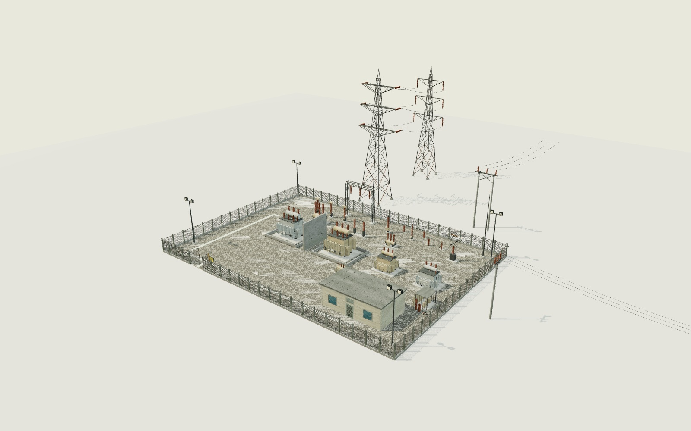

# Substation library review and acceptance

**UK 132 / 33 / 11 kV and Colombia 115 / 34.5 / 13.2 kV**, built from one common machinery pack. This directory reviews a library for later integration. It does not place equipment in the game.

The implementation follows the existing vehicle-library pattern: a catalogue of physical envelopes, quiet staged Blender export, packed named GLB roots, near/far pairs, a separate manifest, independent binary decoding, isolated mutation checks and actual-asset renders.

## Scope and file entry points

- [Authoring, materials, pivots, yard schema and catenary instructions](../../tools/blender/SUBSTATION.md)
- [Measured inventory of all 66 designs](inventory.md)
- [Library manifest](../../assets/models/manifest.substation.json)
- [UK plan](../../tools/blender/substation-plan.uk.json) and [Colombian plan](../../tools/blender/substation-plan.co.json)
- [Atlas metadata, detected text and pixel hashes](../../assets/textures/substation/atlas.json)
- [Standalone review gallery](gallery.html)

All work is new files under `la-ladera/`. The game boot manifest and all `js/` files are unchanged. `manifest.substation.json` is deliberately **not registered** in `assets/models/manifest.json`.

Base verified with `git rev-parse origin/main`: `38542092094aaf0101cc9920fd8628fcdaf0ac35`. The ancestry check also exits zero. Work belongs to `codex/la-ladera-substation-library-20261101`; no main-branch push is part of this change.

## Delivered contents

There are **40 shared machinery designs and 13 site designs per country**, each with a near and far root: **66 designs / 132 roots**. The shared geometry appears once on disk and both variants bind its exact path and SHA-256. Repeated components reference shared glTF meshes; the independently decoded roots contain **801 repeated mesh references**. Small fittings included inside each compound tower are reused within that country pack; this is not a claim that every embedded fitting is globally deduplicated across files.

The set includes the two transformer families, outdoor HV/MV oil breakers, indoor withdrawable oil-breaker truck, portal and switchgear kit, indoor switchboard/control equipment, line towers and poles, country-specific fence/gate/building kits, oil containment, lighting, signs, ground surfaces and small site fittings. The plans place two grid transformers, two distribution transformers and twelve abutting switchboard panels in each yard.

The materials use one shared 1024² PBR atlas layout (base colour, normal and ORM) and one 2048×1024 signs/tags atlas per variant. The signs contain **32 cells per country**, with real Tesseract OCR output and pixel hashes. English and Spanish are checked against independent canonical label lists. The Colombian records preserve accents and `Ñ`. All artwork is original; no utility insignia, manufacturer brand or real station name is used.

Each 55 × 40 m plan has **338 instances, 53 equipment types, eight visitor-route segments and twelve resolved phase spans**. Variant parity permits only the declared variant fields to differ. Types contain the hum, lamp, hinge and seat/standing anchors, navigation exclusions, and empty English/Spanish inspection-note slots. Both variants request a disabled-by-default 100 Hz audio cue; the Colombian 60 Hz electrical profile and the artistic override are documented explicitly. No audio was played.

## Budgets measured from shipped bytes

Task limits below use decimal bytes. The unchanged repository payload script retains its own MB reporting convention.

| Measurement | Actual | Limit |
| --- | ---: | ---: |
| All three GLBs | 2,583,020 bytes | 6,000,000 bytes |
| Five PNGs plus atlas metadata | 2,088,644 bytes | 8,000,000 bytes |
| RGBA8 atlas images including full mip chains | 39,146,836 bytes | 40,000,000 bytes |
| Largest regular near piece | 2,844 triangles | 3,000 triangles |
| Largest transformer near piece | 5,528 triangles | 6,000 triangles |
| Largest far/near ratio | 39.74% | 40% |
| All design near roots combined | 55,912 triangles | Per-piece caps above |
| All design far roots combined | 10,042 triangles | Per-piece caps above |

The common texture cache keeps exactly **five atlas images** resident when both variants have been rendered. The review renderer also allocates a shadow render target; the capture audit records the count before cleanup and then releases only that review target before requiring exactly five textures. Library materials and their uploaded images remain alive during that check. The asset texture cap has not been increased.

The unchanged payload gate passes at approximately **46.2 MB shipped / 150 MB**, **28.9 MB models / 32 MB**, and **289.3 MB estimated GPU textures / 800 MB**. The full output is linked below. The library has about 0.85 MB of texture GPU headroom under its separate 40 MB cap, so adding another atlas would require rebudgeting.

## Acceptance results

Environment: **Node v22.16.0**, Blender **5.0.1**, Linux, Three.js **r180**, hidden headless Chrome with SwiftShader. Blender and rendering use the existing idle-priority wrapper; Node tests import `tests/nice.mjs`. Browser diagnostics contain no console, JavaScript or network errors. The capture tools never use the mouse or speakers.

| Command | Result | Full output |
| --- | --- | --- |
| `node tools/blender/substation_validate.mjs --complete --variant uk` | PASS, all 66 near/far pairs and both-country total budgets | [UK](verification/validate-uk.txt) |
| `node tools/blender/substation_validate.mjs --complete --variant co` | PASS, all 66 near/far pairs and both-country total budgets | [Colombia](verification/validate-co.txt) |
| `node tests/substation-assets.test.mjs` | 15/15 passed | [TAP](verification/assets.tap) |
| `node tests/substation-catenary.test.mjs` | 10/10 passed | [TAP](verification/catenary.tap) |
| `node tests/substation-yard.test.mjs` | 11/11 passed | [TAP](verification/yard.tap) |
| `node tests/substation-asset-mutations.mjs` | 23/23 deliberate mutations rejected | [Output](verification/asset-mutations.txt) |
| `node tests/substation-yard-mutations.mjs` | 21/21 deliberate mutations rejected | [Output](verification/yard-catenary-mutations.txt), [details](verification/yard-catenary-mutations.json) |
| `node tools/substation_plan.mjs` | Both plans pass; 338 matching instances | [Parity output](verification/yard-parity.txt) |
| `node tests/payload.mjs` | PAYLOAD OK, limits unchanged | [Output](verification/payload.txt) |
| `node tools/nice.mjs --idle node tests/substation-shots.mjs` | 66 designs; 14 sheets; five atlas images | [Output](verification/renders.txt), [capture evidence](contact-sheets/evidence.json) |

Commands in the table are relative to `la-ladera/`; the authoring guide gives repository-root commands. The [environment record](verification/environment.txt) records the exact base, branch and Node version. The [complete Blender log](verification/blender-build.txt) records the final build. The [preview guard check](verification/preview-guard.txt) intentionally exits **1** when asked to export a preview inside the shipped asset directory; no nested preview is installed.

A [clean Git export check](verification/clean-export.txt) independently repeats both complete validators, all 36 positive tests, yard parity and the unchanged payload gate. Both complete validators also pass after converting the catalogues, plans, atlas metadata and manifest in that export to CRLF. The exported code/assets are identical to the final staged files after normalizing text line endings; only this evidence log and its README link were added after the export.

The independent validator reads GLB JSON and binary accessors directly, transforms actual vertices, counts drawn triangles, verifies normals/winding/finite data/UV cells, checks every near/far pair and required moving pivot, and compares physical dimensions. It also decodes PNG pixels and CRCs, checks all file and OCR-cell hashes, validates country-specific file/material/sign bindings, and verifies that the boot graph does not reference the library. Text pins normalize CRLF to LF; binary pins are exact.

### Mutation evidence

Every one of the **36 new Node test cases** was rerun unchanged with its own altered input or implementation. The runners require an initially passing baseline, the intended test failure and a nonzero subprocess status; crashes, timeouts and failures for unrelated reasons do not count. The shipped inputs are never mutated.

The 23 asset mutations include a NaN vertex, wrong metre envelope, inflated far geometry, lost hinge, mismatched common hash, broken mesh reuse, corrupt PNG, foreign-language metadata, English raster pixels inserted into a Colombian cell, stale LF source pin, accidental boot registration, unknown plan asset, unaccounted model file, out-of-range UV, lost `Ñ`, wrong GLB hash, shifted atlas cell, UVs in the wrong material cell, duplicated shared-image loading, black vertex-colour multiplication, an English atlas bound to CO, a missing country file list, and a stale manifest texture hash.

The 21 yard/catenary mutations alter analytic sag/endpoint fixtures, segment length, radius, instance caps, invalid-input cases and country voltages; remove a transformer or seat anchor; move a CO instance independently; route through live equipment; shrink a keep-out polygon; move the gate entry; alter schema/intersection fixtures; break deterministic regeneration; or reference a missing line support. The linked JSON describes each change and records the intended assertion failure.

## Contact sheets

Every item is shown from a camera at **1.6 m**, then beside a **1.8 m** reference figure, and again as its far LOD beside the same figure. The sheets are real GLB/PBR renders. The overview images instantiate the supplied plans, including gate pose and instanced catenary segments; they do not use game placement code.

| Sheet | Designs |
| --- | --- |
| [01](contact-sheets/items-01.jpg) | grid transformer; distribution transformer; oil breaker hv; oil breaker mv; breaker truck; portal gantry |
| [02](contact-sheets/items-02.jpg) | disconnector centre; disconnector pantograph; current transformer; voltage transformer; surge arrester; post insulator |
| [03](contact-sheets/items-03.jpg) | earth switch; busbar tube; busbar wire segment; bushing; insulator disc; insulator string |
| [04](contact-sheets/items-04.jpg) | spacer; radiator fin; switchboard panel; control panel; battery bank; charger |
| [05](contact-sheets/items-05.jpg) | desk; chair; schematic board; trench cover; transformer bund; fire wall |
| [06](contact-sheets/items-06.jpg) | oil store; station service transformer; floodlight mast; lightning mast; earth marker; hazard board |
| [07](contact-sheets/items-07.jpg) | tag holder; gravel tile; concrete tile; dry weeds; UK tower suspension; UK tower tension |
| [08](contact-sheets/items-08.jpg) | UK pole mv; UK pole lv; UK fence panel; UK fence post; UK outrigger; UK gate |
| [09](contact-sheets/items-09.jpg) | UK building shell; UK building door; UK louvre; UK window; UK roof; CO tower suspension |
| [10](contact-sheets/items-10.jpg) | CO tower tension; CO pole mv; CO pole lv; CO fence panel; CO fence post; CO outrigger |
| [11](contact-sheets/items-11.jpg) | CO gate; CO building shell; CO building door; CO louvre; CO window; CO roof |

[UK / Colombia comparison](contact-sheets/uk-colombia.jpg) · [UK yard overview](contact-sheets/yard-uk.jpg) · [Colombian yard overview](contact-sheets/yard-co.jpg)

The visual pass corrected UV orientation, common-image reuse, brick scale, overly mottled paint, excessive green algae, a missing real wall schematic, window alignment, transformer and busbar support contact, the gantry wire attachment, loose spare placement and an overlapping earth-marker lid. The final sheets were inspected for missing parts, clipping, obvious support gaps and texture inversion. Roof-on overviews do not expose every indoor panel or chair; those items are shown separately in the contact sheets and checked in the plan data.

## What was not verified

**Clearances are visually plausible, not engineering-certified.** No insulation coordination, fault-duty, earthing, fire-code, protection, thermal, structural/wind or conductor-tension study was performed. The yard is scenery data, not an electrical design or an operational safety plan.

No placement into the live La Ladera world, production camera traversal, game boot performance benchmark or target-hardware GPU/FPS benchmark was performed. The overview deliberately renders near assets for review; SwiftShader timings are not a hardware performance claim. The final integrator must apply LOD, culling and runtime instance batching appropriate to the game budgets.

Pivot names, owned geometry and near/far transforms are checked. A full collision sweep of every animated door, fan, blade and truck movement was not performed. No audio integration or playback was tested. Windows-specific hidden-window flags are implemented but were not exercised on Windows. All imagery is reviewed on the Linux headless renderer; colour management may vary in another host.
