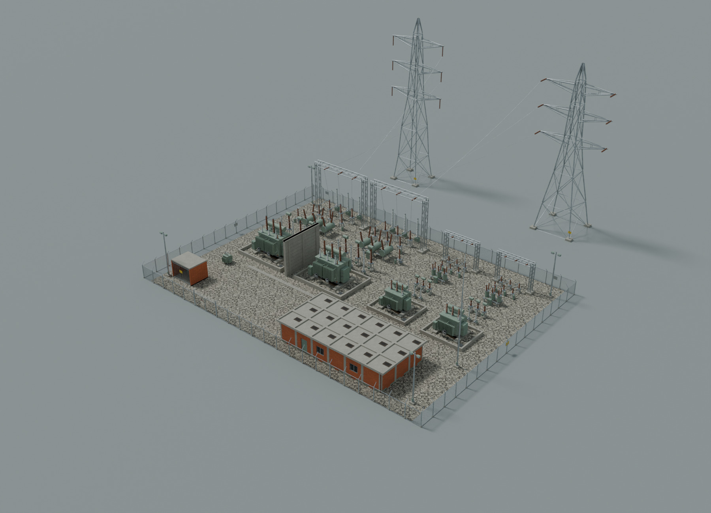

# Substation library verification

Verified 3 November 2026 against the explicitly requested base
`017eab90a749d317f181872aa620b5facaea06f8` on
`codex/la-ladera-substation-library`.

This is an offline asset library and yard-data proposal. It adds 59 equipment
and site types, 59 matching LODs, two packed GLBs, one shared PBR atlas layout,
an illustrative 55 × 40 m yard and an instanced-segment catenary tool. All work
is under `la-ladera/`. Existing production JavaScript and both boot asset
registries are byte-identical to the requested base.

## Base and current-main overlap

During final publication checks, `origin/main` was observed at
`2b0af7cfbde7c77ec8645ed8cd03f6b57d6556b5`, with another substation library added
since the requested base. Eleven of this proposal's new paths also exist there,
including the substation manifest, catalogue, builder and validator. The exact
list is recorded in [main-overlap.json](main-overlap.json).

The requested base and additions-only scope are preserved. This work does not
overwrite, merge, rebase onto or remove that other implementation. The checks
below describe this branch at the requested base, **not the combined result on
current main**. The PR needs explicit reconciliation of those overlapping
implementations before it can be merged. Main has not been pushed or modified.

## Measured release gates

| Item | Result | Limit |
| --- | ---: | ---: |
| Near / LOD roots | 59 / 59 | Every catalogue type |
| Model directory, data and manifest | 3,115,422 bytes | 4,500,000 bytes |
| Near GLB | 2,288,968 bytes; 48,546 triangles | Included above |
| LOD GLB | 559,920 bytes; 8,187 triangles | Included above |
| Largest near model | 5,644 triangles, 132/33 kV transformer | 6,000 for this type; 3,000 for every other type |
| Highest per-piece LOD ratio | 34.88% | 40% |
| Actual repeated GLB mesh references | 170 | Independently checked sharing |
| Shared texture disk size | 3,884,196 bytes | 8,000,000 bytes |
| Texture GPU estimate, RGBA8 + mipmaps | 33,554,432 bytes | 40,000,000 bytes |
| Yard instances | 460 equipment/site records + 2 towers | 55 × 40 m compound, external towers separately recorded |
| Conductors | 36 spans → 903 unit-segment instances | No long conductor meshes shipped |

The model and texture caps above are decimal bytes. The existing repository
payload script prints MiB-sized values with its historical `MB` label; those
outputs are reproduced unchanged below. The GPU texture calculation is a
conservative allocation estimate, not a measured graphics-driver allocation.

## Exact acceptance output

The final runtime is **Node v22.16.0**, Linux x64, with `LADERA_PRIO=idle` and
observed Unix nice priority **19**. See [commands.txt](commands.txt) for the
exact invocations and exit statuses, and [runtime-audit.txt](runtime-audit.txt)
for runtime details and final GLB/PNG hashes.

### Complete independent validator

```text
substation: 59 near + 59 LOD1 (complete)
models: 3,115,422 / 4,500,000 bytes; textures: 3,884,196 / 8,000,000 bytes
texture GPU RGBA+mips: 33,554,432 / 40,000,000 bytes; max near: 5644; max LOD ratio: 34.88%
PASS: binary geometry, metre bounds, catalogue, LODs, atlas, payload and offline isolation.
```

Full output: [validation.txt](validation.txt).

### Tests and actual failing-input mutation checks

```text
1..37
# tests 37
# suites 0
# pass 37
# fail 0
# cancelled 0
# skipped 0
# todo 0
# duration_ms 4732.929116

MUTATIONS: 37/37 killed under v22.16.0
```

The 29 asset/data tests and eight catenary tests all ran. Every one was then
rerun with a deliberate input mutation and had to fail as the exact named
Node test. Success-path cases receive invalid data; rejection cases receive
valid data, so their unchanged rejection assertion must fail. The mutation
runner rejects crashes, timeouts, missing test cases
and absent output as evidence. No test or budget was deleted or weakened.
The complete TAP output is in [tests.txt](tests.txt), and every mutation result
is in [mutations.txt](mutations.txt).

### Existing repository payload test

```text
ok   textures                                                15.7 / 24 MB
ok   models                                                  24.4 / 32 MB
ok   models/people                                            8.9 / 14 MB
ok   models/furniture                                         5.2 / 10 MB
ok   models/world                                             0.0 / 6 MB
ok   models/arch                                              0.0 / 2 MB
ok   shipped total (excl. vendor,dev,labs,tests,tools)       42.9 / 150 MB
ok   estimated GPU texture memory                           278.3 / 800 MB
largest files:
  6.01 MB  assets/models/people/people.glb
  2.80 MB  assets/textures/substation2/atlas.png
  2.28 MB  assets/textures/foliage_cards.png
  2.18 MB  assets/models/substation2/substation2_near.glb
  2.13 MB  assets/models/furniture/furn_shop.glb
  1.89 MB  assets/models/people/people_lod.glb
  1.08 MB  assets/models/furniture/furn_details.glb
  1.03 MB  assets/models/furniture/furn_living.glb
PAYLOAD OK
```

Full output: [payload.txt](payload.txt). Development evidence is excluded from
shipped-total accounting; the existing global per-file cap still applies.
No payload limit or exclusion was changed for this work.

## Visual evidence

The render script imports the final exported GLBs, loads their external PBR
atlas and instantiates the yard from `substation2-plan.json`. It uses Blender
5.0.1 in background mode, Cycles CPU rendering, two threads and idle process
priority. It does not open a browser, move the mouse or play audio.

Every catalogue image uses a camera at **1.60 m** above the studio ground and
a **1.80 m** reference figure. Near and LOD versions are shown separately;
tall structures are framed by increasing camera distance while retaining the
same eye height. The yard eye view is at Y=1.72 m over the plan's Y=0.12 m
surface. The overhead view includes both external towers.

| Contact page | Near geometry | LOD geometry |
| --- | --- | --- |
| 1 — transformers, breakers, switches and instrument transformers | [near 01](contact-near-01.jpg) | [LOD 01](contact-lod-01.jpg) |
| 2 — arresters, indoor equipment and cooling components | [near 02](contact-near-02.jpg) | [LOD 02](contact-lod-02.jpg) |
| 3 — shared components, towers, poles and gantries | [near 03](contact-near-03.jpg) | [LOD 03](contact-lod-03.jpg) |
| 4 — civil works and building shell kit | [near 04](contact-near-04.jpg) | [LOD 04](contact-lod-04.jpg) |
| 5 — security, masts, ground, trenches and signs | [near 05](contact-near-05.jpg) | [LOD 05](contact-lod-05.jpg) |



[Yard at 1.6 m eye height](yard-eye-1_6m.jpg).

The image inventory, camera positions and per-root triangle counts are recorded
in [contact-report.json](contact-report.json). The yard instance count is in
[yard-render-report.json](yard-render-report.json), and
[source-pins.json](source-pins.json) pins the catalogue, manifest, model bytes,
plan and material/texture files used for the evidence. Individual PNG renders
are reproducible with the documented command; the committed contact sheets
contain all 118 images.

[render-audit.json](render-audit.json) records the complete image inventory,
JPEG dimensions/hashes, matched triangle counts, source-pin verification and
the completed visual review. [isolation.json](isolation.json) records the
unchanged boot-registry hashes and additions-only scope check.

Visual review corrected three attachment defects before this release: an
unsupported earth-switch blade in the simplified version, disconnected spacer
bars, and a warning plaque between the H-frame poles. The final geometry keeps
the same reviewed envelopes. The plan preview also now explicitly selects
Euler rotation mode before applying yaw to imported GLB roots, so fence panels,
building side walls and single-phase equipment follow their declared rotations.

## What the checks establish

The binary validator measures geometry rather than trusting the manifest. It
decodes transformed positions, normals, UVs and indices; checks winding,
nondegenerate faces, metre dimensions, base height, per-piece triangle caps,
LOD ratios, actual repeated mesh references and complete catalogue coverage.
It also verifies PNG CRCs, inflates raster data, verifies atlas sizes/rectangles and disk/GPU
caps, counts stale files, checks plan references and selected clearances, and
checks production isolation.

A separate read-only audit verified all 118 manifest copies of anchors and
keep-out polygons against the catalogue, plus all three texture byte lengths
and SHA-256 records against their PNGs. Those particular duplicate-data and
optional texture-hash comparisons are not automatic validator gates; see
[validation-audit.txt](validation-audit.txt) for the precise boundary.

## Not verified

- Integration or combined payload on current `main`, which has advanced and
  contains a different substation implementation. This branch retains the
  explicitly requested base and requires reconciliation before merge.
- Production Three.js rendering, GPU frame time, draw calls, boot timing,
  runtime LOD transitions, or a five-minute first-person game walk. This
  library is not registered or loaded, so these are later integration checks.
- Live transformer audio, lamps, interactive doors, physics blockers or
  navigation around the keep-out polygons. The requested 100 Hz sources,
  lamp/hinge positions and navigation outlines are metadata only.
- Electrical, structural, foundation, oil-volume, fire, drainage, lightning,
  earthing, conductor tension/swing or safe-working-distance certification.
  The layout and clearances are plausible scenery, not engineering-certified.
- Khronos glTF conformance tooling, Windows/macOS execution, or Blender 5.x
  releases other than the recorded 5.0.1 runtime. The independent validator
  and the actual Blender GLB import/render are the checks performed here.

The full catalogue, material-binding contract, regeneration commands and later
instancing guidance are in [SUBSTATION2.md](../../tools/blender/SUBSTATION2.md).
