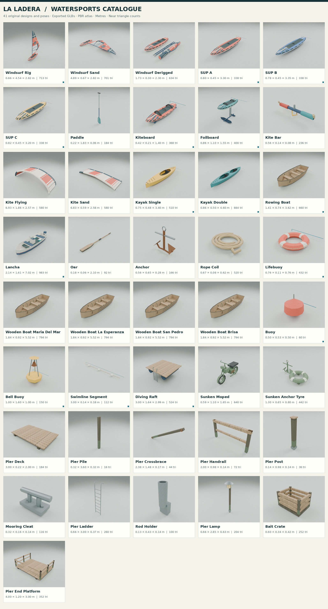

# Watersports library: review and acceptance

Branch: `codex/la-ladera-watersports-20261101`.

The starting `origin/main` was exactly
`38542092094aaf0101cc9920fd8628fcdaf0ac35`; the ancestry check succeeded.
All changes are new files below `la-ladera/`. The library is deliberately absent
from the game's root model manifest, and no existing code or limit was changed.

## Result

| Measure | Actual | Limit |
| --- | ---: | ---: |
| Base designs / far LODs | 41 / 41 | Full requested inventory |
| GLB bytes, three files | 1,023,188 | 2,500,000 |
| Texture bytes, one PBR atlas set | 256,152 | 4,000,000 |
| Atlas dimensions | 2048 x 2048 | 2048 maximum |
| Highest near triangle count | 983, lancha | 2,500 for lancha; 1,500 otherwise |
| Highest far/near triangle ratio | 38.67% | 40% |
| Simple buoy, near / far | 60 / 16 | 60 near |
| Bell buoy, near / far | 150 / 58 | 250 near |
| Pier pile, near / far | 16 / 6 | 16 near |
| Shared mesh definitions used more than once | 29 | Reuse for repeated components |
| Node acceptance tests | 25 passed, 0 failed | All pass |
| Deliberate mutations | 25 killed, 0 survived | One for every new test |

The [technical handoff](../../tools/blender/WATERSPORTS.md) documents the complete
inventory, origins, shared atlas recipes, pivots, anchors, navigation polygons,
motion parameters, colourway remapping and the runtime catenary helper.

## Catalogue and contact sheets



All 41 base designs have an eye-height view with a 1.80 m measuring figure, plus
an elevated close catalogue view. Four transom details and six sail/six kite
colourways bring the total to **98 images**, composed into six review sheets.

| Sheet | Purpose |
| --- | --- |
| [Eye-height sheet 1](contact-eye-01.jpg) | First twelve designs, camera Y=1.60 m, 1.80 m figure |
| [Eye-height sheet 2](contact-eye-02.jpg) | Next twelve designs at the same eye height |
| [Eye-height sheet 3](contact-eye-03.jpg) | Next twelve designs at the same eye height |
| [Eye-height sheet 4](contact-eye-04.jpg) | Remaining five designs at the same eye height |
| [Complete catalogue](catalogue.jpg) | Closer views of every base design |
| [Colourways and transoms](colourways-and-transoms.jpg) | All six sail colours, six kite colours, and four alpha-painted boat names |

The [contact index](contact-index.json) records each source GLB SHA-256, all
three atlas hashes, the camera, 1.80 m figure height, image hash and its rectangle
on the final sheet. The renderer imports the exported GLBs; it does not render
an unexported authoring scene. Floating pieces use an exposed inspection setup,
with a Y=0 datum and lower support plane so fins, foils and ladder draft remain
visible. The scale figure stands at the root datum on a small plinth where needed.

The final render protocol is Blender 5.0.1, background mode, CPU Cycles, four
idle-priority threads, eight samples with denoising, and 512 x 384 source images.
No application window, pointer lock, mouse input or audio was used. All image
processing and heavy commands run through `tools/nice.mjs`, which imports the
existing `tests/nice.mjs` priority helper.

To reproduce the review images:

```sh
node la-ladera/tests/memgate.mjs 6 60
node la-ladera/tools/nice.mjs --idle blender --background --factory-startup \
  --threads 4 --python-exit-code 1 --python la-ladera/tools/blender/watersports_preview.py \
  -- --out /tmp/watersports-renders --width 512 --height 384 --samples 8 --threads 4
node la-ladera/tools/nice.mjs --idle python la-ladera/tools/watersports-contact-sheets.py \
  --renders /tmp/watersports-renders --out la-ladera/dev/watersports
```

Pillow is used only by the development contact-sheet compositor. It is not a
runtime dependency, and the atlas generator itself uses Python's standard library.

## Executed acceptance commands

The acceptance runtime was **Node v22.16.0** and the exporter was **Blender
5.0.1**, build `a3db93c5b259`. Commands below use `node` as shorthand for the
verified Node 22.16.0 executable.

```sh
node --version
node la-ladera/tools/blender/watersports_validate.mjs --complete
node la-ladera/tests/watersports-assets.test.mjs
node la-ladera/tests/watersports-mutations.mjs
node la-ladera/tests/payload.mjs
```

Actual terminal output is saved without substituting expected results:

- [Complete independent decoder output](validation.txt)
- [All 25 Node 22 tests](tests-node22.tap)
- [Passing control and 25 killed mutations](mutations-node22.txt)
- [Aggregate payload gate](payload.txt)
- [Contact-sheet generation output](contacts.txt)

The decoder measures actual positions, normals, UVs, bounds, indices, transforms,
drawn triangle counts, hierarchy and shared mesh references. It checks the fixed
41-design inventory, actual near/far roots, the 40% ratio and special hard caps,
the material recipes, PNG chunks/CRCs/pixels, source pins and atlas/GLB byte
budgets. Text pins normalize CRLF to LF; W18 executes the same gate using CRLF
catalogue, anchor and material files. Waterline depths, local pivot positions,
rider/ladder anchors and navigation polygons are also validated.

## How every new test was mutation-checked

`tests/watersports-mutations.mjs` runs the clean control suite first. It then runs
each named test separately with one deliberately broken input or a temporary
mutated helper module. A nonzero exit only counts when that exact test reports
the intended failure. The source repository's tests, limits and shipped files
are not patched by the mutation run; fixtures live in temporary directories.
Geometry mutations update their GLB hashes so a stale checksum cannot conceal
an ineffective structural check.

| Tests | Deliberate break |
| --- | --- |
| W01-W05 | Remove a GLB; write an actual NaN position; overflow a buffer view; write UV=1.5; write an out-of-range vertex index |
| W06-W10 | Reflect a root; zero a vertex normal; remove a far root; multiply actual primitive counts; rename a real sail pivot |
| W11-W15 | Stale a file hash; corrupt PNG compressed data/CRC; alter draft metadata; invert ladder endpoints; add the library to the boot manifest |
| W16-W18 | Replace shared mesh references with unique copies; remove a colourway; change pinned text content after testing equivalent LF/CRLF forms |
| W19 | Reverse both hull winding and normals together, so generic winding checks still pass but the nearest exterior surface faces inward |
| L01-L05 | Corrupt a catenary endpoint; discard 90% of slack; break degenerate-span handling; remove the segment-count guard; stop reusing the supplied buffer |
| V01 | Mutate shared source UVs instead of cloning affected geometry |

### Two visual findings became concrete regression checks

The first exported boat hulls had internally consistent winding and normals
that faced into the boat. W19 was observed failing on those actual old bytes:
[initial red output](hull-before.tap). Its exterior rays now check the closest
physical surfaces on both sides and at the ends of the boats, independently of
mesh names or vertex order.

Close transom renders then exposed overlapping inner and outer end caps. The
corrected hulls have 50 mm of transom/bow thickness, and their name decals crop
the real atlas lettering band to produce approximately 9-10 cm painted letters.
W19 includes an additional negative control that collapses the two decoded cap
planes together, proves generic normal/winding checks still pass, and rejects
the opposing coplanar end surfaces: [executed control](endcaps-control.tap).
The old capped GLB had already been replaced when that new control ran; the
check uses a faithful mutated binary and does not claim an observed pre-fix
test run for the cap defect.

## What was not verified

This change does not place the assets in the game. It does not claim measured
world frame time, actual GPU draw calls, boot timing after future registration,
live LOD transitions, water/rock/bob animation, riding controls, character IK,
ladder traversal, underwater shading, assembled-pier collision or navigation.
Those require the later coast integration. The numerical far-LOD checks do not
replace an in-game LOD transition review. Native Windows Blender execution was
not run; text pin portability was exercised with real CRLF fixture bytes.

All new geometry, atlas patterns, painted lettering and graphics are original
procedural work, released as CC0-1.0 in the asset manifest. No external meshes,
textures, real badges or brand logos are included.
